# Images

Every image here is exactly what the models were shown: one camera view of one scene, rendered in Isaac Sim. These are a few examples of what changes between scenes, which cameras can show the answer, and the scenes right on the line.

## What changes between scenes

Each scene changes the step being checked. For the cart, the same overhead camera shows:

| Seated | Off the shelf | Tilted on the edge |
|---|---|---|
| 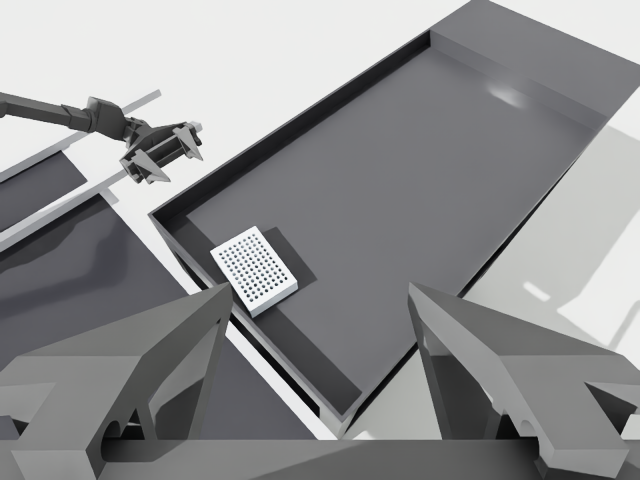 | 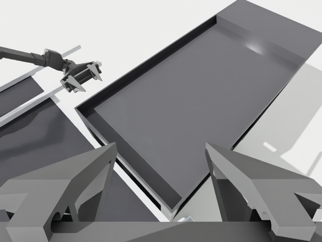 | 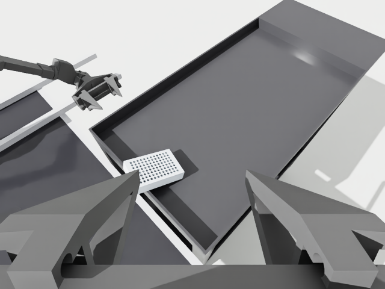 |
| The plate sits flat on the top shelf. | The plate fell off, so the shelf is empty. | The plate rests on the shelf’s lip. |

For the pipette, the close-up camera shows where the tip ends:

| In a well | Too high above the plate |
|---|---|
| 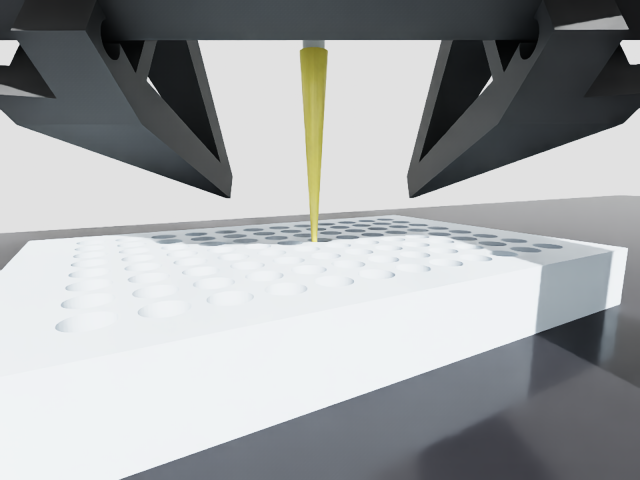 | 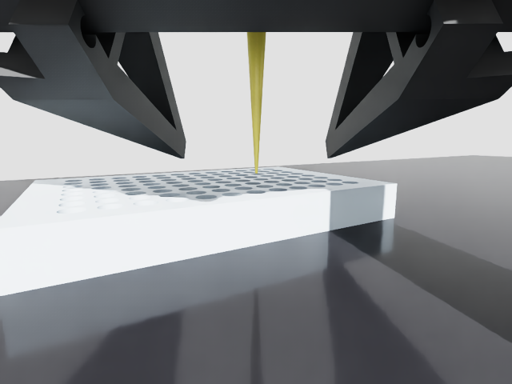 |

## When the camera can show the answer, and when it can’t

Each row is one scene seen from two cameras. Only the first camera can show the answer, so the right answer depends on the camera.

| Scene | Camera that shows the answer | Camera that can’t |
|---|---|---|
| **Pipette:** tip too high above the plate |  Close-up camera. Right answer: “too high above the plate”. | 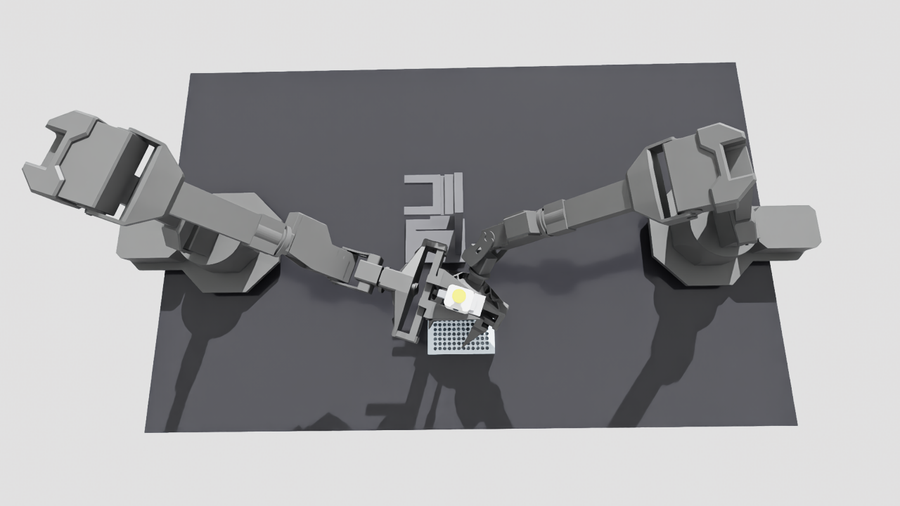 Overhead camera: the pipette hides its own tip. Right answer: “can’t tell”. |
| **Grip:** only one arm gripping | 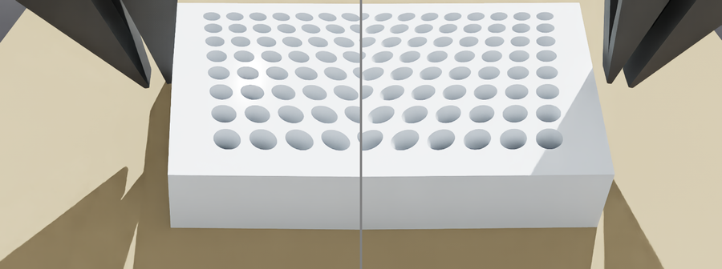 End cameras, shown side by side: you can see where each gripper meets the plate. Right answer: “only one arm gripping”. | 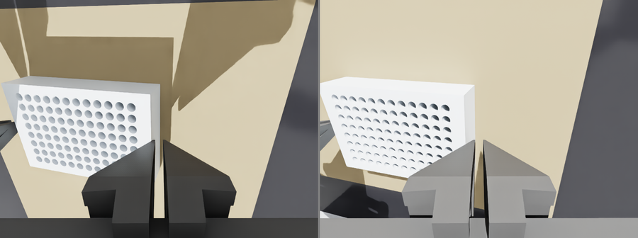 Wrist cameras, shown side by side: each gripper hides its own contact. Right answer: “can’t tell”. |
| **Cart:** the plate fell off |  Overhead camera: the shelf is empty. Right answer: “off the shelf”. | 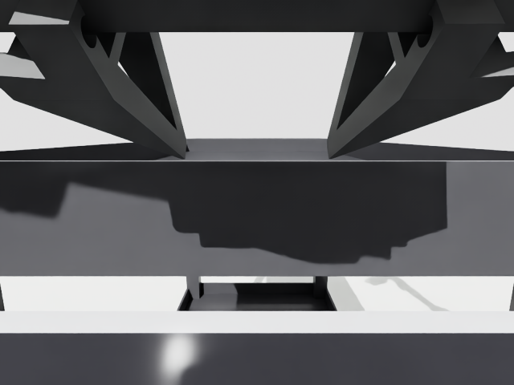 Low camera: the shelf’s lip hides the deck, so a seated plate looks the same. Right answer: “can’t tell”. |

## Scenes right on the line

We intentionally tested 15 scenes right on the line. They count in Figure 1 but are not graded right or wrong (see [How it was tested](../README.md#how-it-was-tested)).

| Tip 1 mm above the plate | Tip resting on a well’s edge | Plate just touching the shelf lip |
|---|---|---|
| 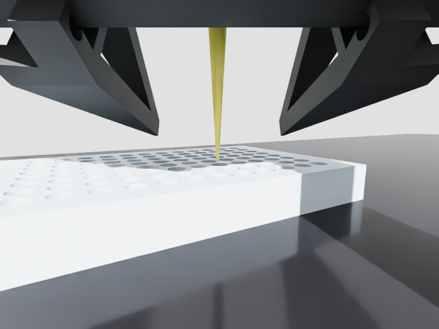 | 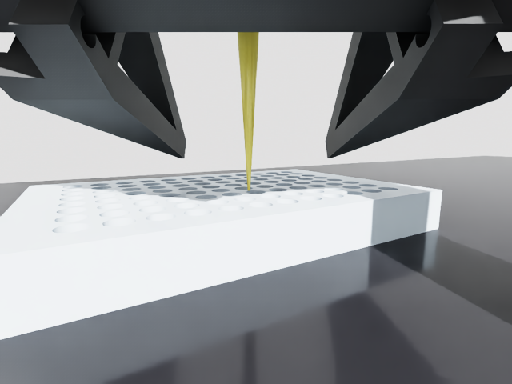 | 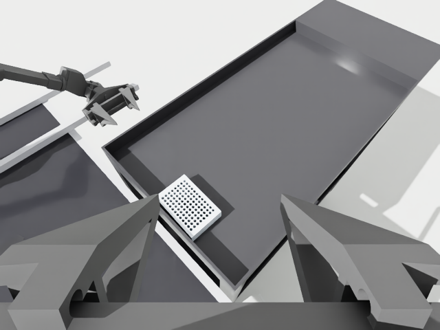 |
